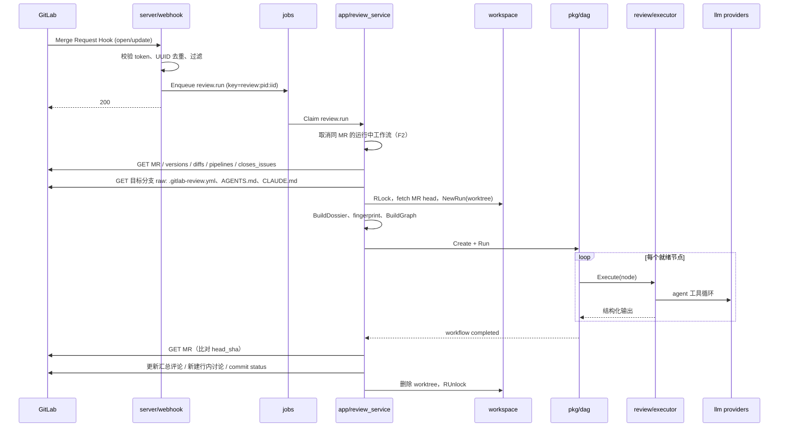

# 05 关键流程

> 每个流程列出参与组件、步骤和调用的 GitLab API。实现时按步骤写函数，每一步失败的处理也写在这里。

---

## F1 MR 打开或更新 → 评审 → 发布

### 步骤与失败处理

| # | 步骤 | 失败处理 |
|---|---|---|
| 1 | webhook 校验、去重、入队 | 认证失败 401；其余异常记日志后仍返回 200 |
| 2 | worker 领取 job | 租约 5 分钟，执行中每分钟续期 |
| 3 | 取消旧工作流（F2） | — |
| 4 | 拉取 MR 元数据：`GET /projects/:id/merge_requests/:iid` | MR 已关闭或合并 → job 完成，不评审 |
| 5 | `GET .../merge_requests/:iid/versions` 取最新版本的三个 sha | 失败 → job 重试 |
| 6 | `GET .../merge_requests/:iid/diffs`（翻页） | 同上 |
| 7 | `GET .../merge_requests/:iid/pipelines`，取最新一条；有失败 job 时 `GET /projects/:id/pipelines/:pid/jobs` | 失败不阻塞，`Pipeline=nil` |
| 8 | `GET .../merge_requests/:iid/closes_issues` | 失败不阻塞 |
| 9 | 读目标分支上的 `.gitlab-review.yml`、`AGENTS.md`、`CLAUDE.md`：`GET /projects/:id/repository/files/:path/raw?ref=<target>` | 404 视为没有 |
| 10 | 合并配置（平台 → 项目 → 仓库）；计算 ignore；增量范围 | 配置非法 → 用项目配置，并在汇总中提示 |
| 11 | 工作区 `RLock`；`git fetch refs/merge-requests/<iid>/head`；`git worktree add <runs>/<wf> <head_sha>` | fetch 失败 → job 重试 |
| 12 | 变更文件为 0（全被 ignore）→ 发布「无需评审」的汇总，结束 | — |
| 13 | `BuildGraph` → `Engine.Create` → `Engine.Run` | 工作流 failed → F1-失败分支 |
| 14 | 发布（F7） | GitLab 写入失败 → 重试 3 次；仍失败记录到工作流，控制台可手动 republish |
| 15 | 清理 worktree，释放锁 | 清理失败只记日志，由定期任务兜底 |

**F1-失败分支**：工作流 `failed` 时，若项目设置 `post_failure_note=true`（默认 true），发布或更新汇总评论为「⚪ 评审未完成：<原因>」，不写 commit status。

### 增量评审

- 上次已发布的工作流记录了 `head_sha`。新工作流在 `trigger=mr_update` 且非 `full` 时，只把 `git diff <last_head>..<head>` 涉及的文件作为评审范围；diff 内容仍取 MR 相对 base 的完整 diff，以保证行号映射正确。
- 上次的 head 不再是当前 head 的祖先（force push）→ 自动退回全量。

---

## F2 新 push 取消旧评审

1. `review_service` 领取新 job 后，查询 `workflows_active_review` 中同 `(project_id, mr_iid)` 的工作流。
2. 对其调用 `Engine.Cancel(wf, "superseded_by:<new_wf>")`：运行中节点的 context 被取消，LLM 请求中断。
3. 旧工作流不会发布任何内容（发布前 fingerprint 校验也会拦住迟到的结果）。
4. 新工作流开始 F1 第 4 步。

---

## F3 评论命令

1. Note Hook 到达，正文以 `/review` 开头。
2. 忽略：作者是项目 bot 用户；MR 已关闭或合并。
3. 校验权限：`GET /projects/:id/members/all/:user_id`，`access_level < 30` → 回复「需要 Developer 及以上权限」，结束。
4. 解析命令（03-http-api.md §6）：
   - `/review`、`/review full`、`/review <profile>` → 入队 `review.run`（trigger=`command`，带 `full`、`profile`、`triggered_by`）。
   - `/review cancel` → 入队 `review.cancel`。
   - `/review help` → 直接回复说明。
5. 给原评论加 👀 表情表示已受理（`POST .../notes/:note_id/award_emoji`，`name=eyes`）。

---

## F4 目标分支 push → 刷新工作区

1. Push Hook 到达，`ref` 匹配目标分支 → 入队 `workspace.refresh`（key=`ws:<pid>`，自动合并重复）。
2. 工作区 `Lock`（等待进行中的评审释放读锁，最长 10 分钟，超时则延后重试）。
3. `git fetch`，`base/` 检出到新的 `after` sha；`workspaces.base_sha` 更新。
4. 外部索引增量更新（如 `codebase-memory-mcp cli index_repository`，cwd 为 `base/`）。
5. 判断是否重新生成上下文文档：自上次生成以来变更文件数 ≥ `context_refresh.changed_files`，或时间 ≥ `context_refresh.max_age`，且当前文档未锁定 → 运行 onboarding 工作流（F5 第 4 步起）。
6. 释放锁。

---

## F5 项目注册与 onboarding

1. 管理员调用 `POST /api/v1/projects`（03-http-api.md §4.1），服务端校验 token 和 scope。
2. 可选：创建 webhook。
3. 入库，`workspaces.state=new`，入队 `workspace.onboard`。
4. onboarding job：
   1. `state=onboarding`；`EnsureMirror` + 检出 `base/`。
   2. 建外部索引（按平台和项目配置的 MCP 中声明了 `index_command` 的服务器）。
   3. 读取目标分支上的 AGENTS.md / CLAUDE.md。
   4. 创建 onboarding 工作流（单节点），产出 `OnboardingOut`。
   5. 渲染为 Markdown，写入 `context_docs`（`source=generated`）；若当前有锁定版本，只写入不切换。
   6. `state=ready`。
5. 任一步失败：`state=error`，`last_error` 记录原因；评审仍可进行，只是没有上下文文档和索引。

---

## F6 崩溃恢复

服务启动时依次执行：

1. `jobs`：`state=running` 且租约过期的任务改回 `queued`，`attempts+1`；超过 `max_attempts` 的标为 `failed`。
2. `Engine.Recover`：对每个未终态工作流，
   - `running` 节点：写 `node.restarted`，重置为 `pending`，`attempt+1`。
   - `queued` 节点：保持 `queued`（幂等重入）。
   - 然后重新进入调度循环。
3. 评审节点无副作用，重跑安全。发布阶段靠 F7 的幂等保证不会重复评论。
4. 遗留的 `runs/*` 目录在启动时清理（对应工作流已终态的才删）。

---

## F7 发布（幂等）

前置：工作流 `completed`。

1. **fingerprint 校验**：重新 `GET MR`，若 `head_sha` 已变化 → 不发布，工作流记 `cancel_reason=stale`。
2. **汇总评论**：
   1. 查 `publications(kind=summary)`；有 `gitlab_id` → `PUT .../notes/:note_id` 更新。
   2. 没有记录 → 列出 MR 的 notes，找作者为本 bot 且正文首行含 `<!-- gitlab-ce-review:summary` 的评论；找到则更新并补记录，找不到则新建。
3. **行内讨论**：对 `decision ∈ {publish, mark}` 且 `position_ok` 的 finding：
   1. 用 `publish_key` 查 `publications(kind=discussion)`；已存在（同一问题之前发过）→ 跳过，不重复评论。
   2. 否则 `POST .../discussions`，position 由 `DiffIndex.Locate` 生成；返回 400 → 降级进汇总的「无法定位」区块。
   3. 写 `publications`。
4. **commit status**（项目开启时）：`POST /projects/:id/statuses/:head_sha`，`name=ai-review`，`state=success|failed`，`target_url` 指向控制台评审详情，`description` ≤ 140 字符。
5. 每一步写 `publications` 与调用 GitLab 不在同一事务：先调用 GitLab 成功，再写记录；崩溃导致漏记时，第 2.2 步的标记查找可以兜底汇总评论，行内讨论则可能重复一条（可接受，并在下一次运行时以 `publish_key` 去重）。

---

## F8 反馈收集

定时任务（默认每 6 小时）：

1. 找出最近 14 天内发布过、且 MR 仍打开或在最近 3 天内合并的 publication。
2. 汇总评论和行内讨论：`GET .../notes/:note_id/award_emoji`，记录 👍（`thumbsup`）/ 👎（`thumbsdown`）。
3. 行内讨论：`GET .../discussions/:discussion_id`，若已 resolved，比较 finding 所在行在当前 head 中是否被改动（`git diff <published_head>..<current_head> -- <path>` 覆盖该行）→ `resolved_changed` / `resolved_unchanged`。
4. 写入 `feedback`（唯一约束保证幂等）。
5. 统计口径（控制台展示）：
   - 提出方准确率 ≈ (👍 + resolved_changed) / 已发布条目数
   - 挑战方误杀率需要抽样：从 `drop` 的条目中按比例抽取，在控制台提供人工标注入口（M6）。
